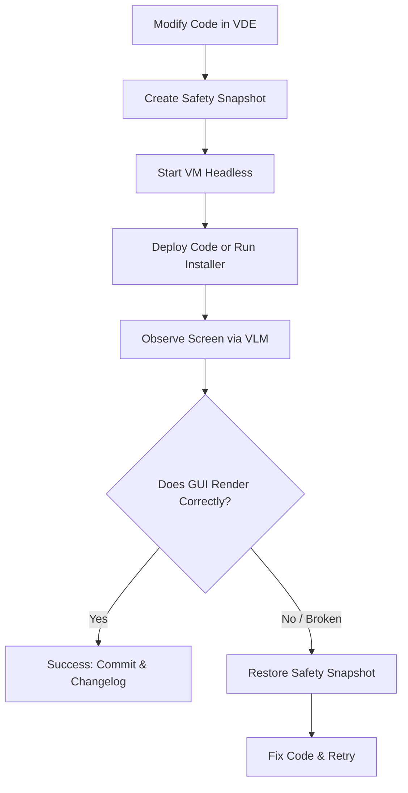

# VDE-VLM VirtualBox Agent Controller

This skill gives you (Gemini, Antigravity, Claude, or any VLM agent) direct perception and control over Oracle VirtualBox Virtual Machines. You can see the VM desktop through screenshots, read UI coordinates using grid overlays, send keyboard/mouse input, execute commands inside the guest, and manage snapshot checkpoints.

---

## 1. Quick Reference Commands

All commands can be invoked using `run_command` in PowerShell or bash:

```powershell
# 1. Discover VMs and their states
python -m vde_vlm list

# 2. Boot a VM in headless mode (no host window clutter)
python -m vde_vlm start "vmvdebox6.1"

# 3. Take a multimodal observation (captures screenshot + grid overlay)
python -m vde_vlm observe "vmvdebox6.1"

# 4. View the screenshot in your context
# Call read_file on the screenshot or grid_screenshot path returned by observe!

# 5. Click an element seen on screen (e.g. at pixel x=450, y=720)
python -m vde_vlm click "vmvdebox6.1" 450 720 --verify

# 6. Type text or commands
python -m vde_vlm type "vmvdebox6.1" "systemctl status vde" --enter

# 7. Press hotkeys or special chords
python -m vde_vlm key "vmvdebox6.1" "ctrl+alt+t"
python -m vde_vlm key "vmvdebox6.1" "super"
python -m vde_vlm key "vmvdebox6.1" "enter"
python -m vde_vlm key "vmvdebox6.1" "esc"

# 8. Run a command inside guest directly
python -m vde_vlm exec "vmvdebox6.1" "ls -la /home/victor" --user victor

# 9. Create a snapshot before making big changes
python -m vde_vlm snapshot "vmvdebox6.1" take "before-vde-install"

# 10. Rollback if something breaks
python -m vde_vlm snapshot "vmvdebox6.1" restore "before-vde-install"

# 11. Stop the VM when finished
python -m vde_vlm stop "vmvdebox6.1" --mode poweroff
```

---

## 2. Recommended Agent Workflow for Testing VDE

When you modify code in `VDE` and want to verify it in the VirtualBox VM:



### Step 1: Create a Checkpoint Snapshot
```powershell
python -m vde_vlm snapshot "vmvdebox6.1" take "pre-test"
```

### Step 2: Start the VM Headless
```powershell
python -m vde_vlm start "vmvdebox6.1"
```

### Step 3: Observe Current Screen
Run `python -m vde_vlm observe "vmvdebox6.1"` and call `read_file` on `grid_screenshot`.
The grid overlay has red/cyan lines and coordinate numbers every 100px:
- Look at the UI button or window you want to interact with.
- Read its `(x, y)` coordinate from the grid lines.
- Click it: `python -m vde_vlm click "vmvdebox6.1" <x> <y>`.

### Step 4: Verify Actions
When running `click` with `--verify`, `vde_vlm` measures the pixel difference percentage between before and after the action. If `changed: true`, the UI responded to your click.

---

## 3. Python API Integration

You can also write custom automated scripts in Python:

```python
from vde_vlm import VBoxVM

vm = VBoxVM("vmvdebox6.1")

# Boot
vm.start(headless=True)

# Safe transactional checkpoint
with vm.checkpoint("install_run"):
    obs = vm.observe(grid=True)
    print("Screenshot at:", obs["grid_screenshot"])
    
    # Send Super key to open VDE start menu
    vm.press_key("super")
    
    # Observe updated menu
    new_obs = vm.observe()
```
